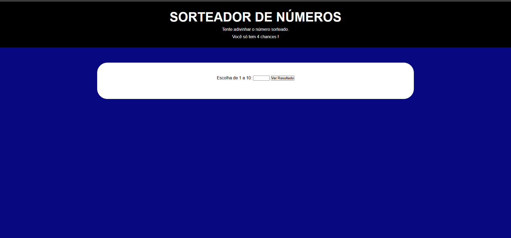

# Jogo De Adivinhação

- Esse projeto possui um sistema que sorteia números aleatórios entre 1 e 10. O usuário terá que descobrir qual foi o número sorteado, tendo 4 tentativas para acertar. Caso acerte, aparecerá "Parabéns, você acertou!", se não, o usuário é bloqueado do sistema e só poderá tentar novamente depois de 30 minutos.

## Demonstração



* [Ver o site do projeto](https://gkptan.github.io/Javascript/exerc%C3%ADcios/ex012/index.html)

## Estrutura do projeto
```
├── ex012/
    ├── README.md
    ├── guessingGame.png
    ├── index.html
    ├── index.js
    ├── responsivo.css
    └── style.css
```
## Tecnologias Utilizadas

### Linguagens e Markup
- HTML
- CSS
- JavaScript

## Aprendizados
- JavaScript - loops com for e while.

## Problemas e Bugs
- Existe um bug específico que acontece às vezes. Nesse bug, o site reinicia após a primeira ou segunda alternativa, independente de acerto ou erro. Quem quiser resolver esse problema, Sinta-se à vontade para corrigir.

## Autor
- Guilherme Amorim
* [Linkedin](https://www.linkedin.com/in/guilherme-dos-santos-amorim-43b57a28b/)
* [Portfólio](https://gkptan.github.io/)
